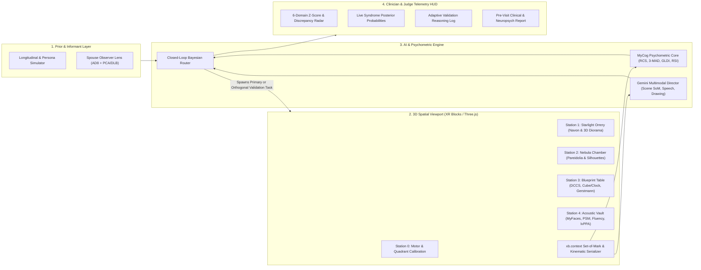

# PostCircECD ("The Celestial Observatory"): Master Specification
## Clinical Depth, Psychometric & Psychomotor Rigor, and SOTA 3D Spatial Platform (`XR Blocks` + Gemini)

> [!IMPORTANT]
> This specification synt[PostCirc ECD Master Specification](PostCirc ECD Master Specification.md)hesizes clinical neurology requirements (MoCA/ACE-III subscores, Bálint/Gerstmann screens, DLB pareidolias/fluctuations, lvPPA phonological loop, and informant AD8/IQCODE) with the empirical psychometric standards in [`MyCogTechSpec.md`](file:///Users/o2satz/Downloads/PostCircECD/MyCogTechSpec.md) and Google XR Labs' **`xrblocks`** spatial AI architecture.
> Workspace copy saved at: [`MASTER_CLINICAL_PSYCHOMETRIC_3D_SPEC.md`](file:///Users/o2satz/Downloads/PostCircECD/MASTER_CLINICAL_PSYCHOMETRIC_3D_SPEC.md).

---

## 1. Pillar I: Clinical Depth & Differential Phenotyping

### 1.1 The Clinical Problem We Solve
Standard primary-care screens (MMSE, Mini-Cog, total-score MoCA) and current two-factor digital screeners (such as MyCog, which evaluates only *Episodic Memory* and *Executive Function*) systematically miss or misclassify four high-priority populations:
1. **High-Functioning Individuals with Early Cognitive Decline (Age 50–75):** High verbal/educational reserve allows patients to score $\ge 26/30$ on the MoCA despite losing 1.5–2.5 SD from their personal baseline in visuospatial, executive, or associative binding domains.
2. **Posterior Cortical Atrophy (PCA — "Visual Variant" AD):** Occipitoparietal (dorsal stream) and occipitotemporal (ventral stream) degeneration causes early **Bálint syndrome** (*simultanagnosia, optic ataxia, ocular apraxia*), **Gerstmann syndrome** (*acalculia, agraphia, finger agnosia, left-right confusion*), **visual crowding**, and **apperceptive/associative agnosias** while episodic memory and insight remain relatively spared. Because standard digital memory tests (e.g., MyCog Picture Sequence Memory) rely on visual stimuli, PCA patients fail memory tests *secondarily to visual perceptual breakdown*, causing misdiagnosis as primary amnestic MCI or optometric/psychiatric issues.
3. **Dementia with Lewy Bodies (DLB):** Characterized by early **visuoperceptual pareidolias**, **moment-to-moment cognitive/attentional fluctuations**, **visuoconstructional impairment**, **retrieval-type memory deficits** (rescued by cues), and prodromal **REM sleep behavior disorder (RBD)** or **anosmia**.
4. **Other Atypical Alzheimer Variants:**
   - **Logopenic Variant Primary Progressive Aphasia (lvPPA):** Left posterior perisylvian/temporoparietal atrophy impairs the **phonological working memory buffer**, causing length-dependent sentence repetition failure, word-finding pauses, and phonemic paraphasias with spared single-word comprehension.
   - **Frontal / Dysexecutive AD:** Disproportionate impairment in working memory manipulation, inhibitory control, and set-shifting efficiency.

---

### 1.2 Comprehensive Domain-to-Syndrome Clinical Matrix

| Clinical Domain | Neuroanatomical Substrate | Primary 3D Station Task | Closed-Loop "Similar-but-Different" Convergent Validation Task | Target Syndrome Differentiated |
| :--- | :--- | :--- | :--- | :--- |
| **0. Ecological & Prodromal Intake** | Whole-brain real-world functional integrity + Brainstem/Olfactory (DLB) | **Patient Subjective Micro-Query** (5 items: reading line-tracking, night/depth driving, cluttered surfaces, word-finding, dream enactment) | **Spouse/Informant Digital Co-Pilot** (AD8 / IQCODE + 6-item Posterior/DLB Real-World Addendum) | Establishes **Bayesian Prior** & quantifies **Anosognosia / Informant Discrepancy** |
| **1A. Dorsal Visual Stream ("Where/How")** | Bilateral superior parietal lobule, parieto-occipital sulcus (Bálint spectrum) | **3D Navon Constellation Orrery:** Timed recognition of Global macro-shapes vs. Local micro-elements across escalating 3D spatial crowding densities | **1. 3D Harbor Diorama Spoken Scene Synthesis** (Simultanagnosia check via Gemini + `xb.context` Set-of-Mark) **2. Quadrant Peripheral Prism Intercept** (Optic Ataxia ballistic reach check) | **PCA (Dorsal / Bálint)** vs. primary ocular issue or generalized slowing |
| **1B. Ventral Visual Stream ("What") & Pareidolia** | Inferior temporo-occipital cortex (fusiform/lingual) & cholinergic visual network | **The Nebula & Relief Chamber:** Procedural 3D noise clouds/stone reliefs (50% embedded faces/objects, 50% pure fractal noise) + **Overlapping 3D Wireframes (Poppelreuter)** | **If Pareidolia False Alarms $\ge 2$:** Trigger **Continuous Vigilance Pulses** across session (DLB fluctuation check) **If Object Misses $\ge 2$:** Trigger **3D Foreshortened Silhouette Rotation** (VOSP Unusual Views analog) | **DLB (Pareidolias)** vs. **PCA Ventral (Apperceptive Agnosia)** |
| **2A. Visuoconstruction & Spatial Planning** | Right > Left parietal-frontal constructional network | **The Architect's Blueprint Table:** 3D Structural Truss / Cube Copy + Interactive Astronomical Clock ("Ten past eleven") | **3D Infinity-Loop / Intersecting Polyhedra Wireframe Trace** (ACE-III visuospatial cross-check) | **PCA & DLB** (severe spatial/conceptual clock & cube distortion) vs. Normal Aging |
| **2B. Left Angular Gyrus (Gerstmann Tetrad)** | Dominant inferior parietal lobule / angular gyrus | **Parietal Trigger:** Activated if Cube/Clock shows spatial disorganization or prior history flags parietal signs | **The Automaton's Hands & Scale:** 1. 3D Articulated Hand Mental Rotation (*Left/Right + Finger Agnosia*) 2. Sequential Counterweight Arithmetic (*Acalculia*) 3. Dictated Log Inscription (*Agraphia*) | **PCA / Parietal AD (Gerstmann Syndrome)** |
| **3. Executive Function, Set-Shifting & Vigilance** | Dorsolateral prefrontal, anterior cingulate, frontostriatal loops | **3D Prism Switchboard (DCCS + Trails B Hybrid):** 30 mixed trials (23 repeat, 7 switch) routing light beams by Geometry vs. Spectrum | **Dual-Task Spatial-Acoustic Switch:** Tracking a moving 3D orb while sorting high/low frequency chimes (strips away slow verbal compensation in high-functioning users) | **High-Functioning Early MCI**, **Dysexecutive AD**, and **DLB (RT Fluctuation Index)** |
| **4. Language, Fluency & Phonological Buffer** | Left inferior frontal (Broca), temporoparietal junction (Wernicke/SMG) | **The Resonance Lexicon:** • 60s Letter-F Fluency • 60s Category (Animals) Fluency • Low-frequency 3D Silhouette Naming | **The Echo Relay (lvPPA Validation):** Repeating acoustic transmissions of escalating syllable length & low word probability + Semantic Association check | **Logopenic PPA** (length-dependent repetition drop + pauses, spared semantics) vs. Semantic/Frontal variants |
| **5. Associative & Episodic Sequence Memory (De-Confounded)** | Hippocampus, entorhinal cortex, precuneus, prefrontal retrieval networks | **Expedition Crew & Artifact Sequence (MyFaces + PSM Hybrid):** • 8–12 3D Explorer Faces + Names + Sequence Order • Delayed Free Recall $\rightarrow$ First-Letter Recall $\rightarrow$ Cued Name Matching | **Modality De-Confounding Validation:** • If Visual Stream (Station 1) is impaired, automatically administers **Auditory-Verbal Sequence** to prove whether low visual memory was a **PCA visual encoding artifact** vs. true **Hippocampal Storage Failure** | **Amnestic AD** (fails free & cued across modalities) vs. **DLB/Frontal** (rescued by cues) vs. **PCA** (intact auditory recall, impaired visual encoding) |

---

## 2. Pillar II: Psychometric & Psychomotor Rigor

Our scoring engine directly implements the peer-reviewed algorithms documented in [`MyCogTechSpec.md`](file:///Users/o2satz/Downloads/PostCircECD/MyCogTechSpec.md) while solving its five published limitations.

### 2.1 Baseline Motor & Hardware Latency Calibration (Room 0)
`MyCogTechSpec.md` (Section 4.5) documents that hardware/OS differences shift raw scores (e.g., iOS `18.80` vs. Android `17.11` on Arranging Pictures) because no input-latency calibration exists.
* **Calibration Protocol (20 seconds):** The user intercepts 12 high-contrast glowing spheres appearing sequentially at the center and across the 4 visual quadrants ($Q_1..Q_4$).
* **Extracted Baselines:**
  1. **Baseline Motor Reaction Time ($RT_{\text{motor}}$):** Subtracted from downstream cognitive reaction times to eliminate hardware/motor lag.
  2. **Quadrant Asymmetry Index ($QAI$):**
     $$QAI = \frac{\max_{q \in \{1..4\}} (\text{Median } RT_q) - \min_{q \in \{1..4\}} (\text{Median } RT_q)}{RT_{\text{motor}}}$$
     Flags hemifield neglect or quadrant-specific **Optic Ataxia** up front.
  3. **3D Ballistic Reach Efficiency ($\eta_{\text{reach}}$):**
     $$\eta_{\text{reach}} = \frac{\text{Euclidean Distance}(P_{\text{start}}, P_{\text{target}})}{\int_{t_0}^{t_{\text{hit}}} \|\mathbf{v}(t)\| \, dt}$$
     Quantifies cursor/hand path straightness and terminal sub-movement oscillations.

### 2.2 Outlier Trimming & Executive Rate-Correct Score (MyCog 2.0 Standard + Extensions)
Following [`MyCogTechSpec.md`](file:///Users/o2satz/Downloads/PostCircECD/MyCogTechSpec.md#L143-L150) (Section 2.2):
* **3-MAD Outlier Trimming:** With individual median $M = \text{median}(RT)$ and $\text{MAD} = \text{median}(|RT_i - M|)$, exclude any trial where:
  $$RT_i < 100\text{ ms} \quad \text{or} \quad RT_i > 9000\text{ ms} \quad \text{or} \quad |RT_i - M| > 3 \cdot \text{MAD}$$
* **Rate-Correct Score ($\text{RCS}$):**
  $$\text{RCS} = \frac{C_{\text{valid}}}{\sum_{i \in \text{valid}} RT_i}$$
* **Switch-Cost Efficiency Ratio ($\text{SCER}$):**
  $$\text{SCER} = 1 - \frac{\text{RCS}_{\text{switch}}}{\text{RCS}_{\text{repeat}}}$$
  Catches micro-hesitations on set-shifting trials in high-functioning individuals who still achieve $100\%$ accuracy.
* **DLB Cognitive Fluctuation Index ($\text{CoMAD}$):**
  $$\text{CoMAD} = \frac{\text{MAD}}{M}$$
  Quantifies moment-to-moment attentional instability across the session.

### 2.3 Visuoperceptual, Episodic & Associative Memory Metrics
* **Navon Global-Local Dominance Index ($\text{GLDI}$):** $\text{GLDI} = \text{RCS}_{\text{Global}} / \text{RCS}_{\text{Local}}$ (values $<0.55$ flag **Simultanagnosia / Local Capture**).
* **Pareidolia Discriminability:** Separates **DLB Pareidolia False Alarms** ($FA_{\text{noise}} \ge 0.30$ in pure procedural noise) from **PCA Ventral Apperceptive Misses** ($Hit_{\text{signal}} \le 0.50$).
* **Dual Sequence Scoring:** Computes both **MyCog Exact-Position Score ($S_{\text{exact}}$)** and **NIH Toolbox Adjacent-Pair Score ($S_{\text{adj}}$)**.
* **Associative Memory Retrieval vs. Storage Index ($\text{RSI}$):**
  $$\text{RSI} = \frac{S_{\text{match}} - S_{\text{letter}}}{L - S_{\text{letter}}}$$
  Distinguishes **Cued Retrieval Rescue** ($\text{RSI} \ge 0.75$, typical of DLB/Frontal) from **Consolidation/Storage Failure** ($\text{RSI} \le 0.30$, typical of hippocampal AD).

---

## 3. Pillar III: SOTA 3D Spatial Platform (`XR Blocks` + Three.js + Gemini)

### Key Platform Capabilities
1. **`xb.Script` Modular 3D Stations & World-Space `uiblocks` (`Panel`):** Smooth 3D camera flight between stations in **The Celestial Observatory**, with ergonomic high-contrast 3D panels and mandatory interactive practice trials (per MyCog 2.0 older-adult design guidelines).
2. **`xb.context` Set-of-Mark (SoM) Scene Graph for Gemini:** Sends real-time frustum visibility and 3D object quadrant coordinates to Gemini during spoken scene description to objectively score **Simultanagnosia vs. Global Scene Integration**.
3. **Clinician & Judge Telemetry HUD + Persona Simulator:** Allows live playthrough *or* one-click loading of clinical profiles (*High-Reserve Dorsal PCA*, *Prodromal DLB*, *Logopenic PPA*, *Repeat Longitudinal Visit*) with real-time Bayesian posterior curves and a printable **Office-Visit Clinical Decision Report**.

---

## 4. Pillar IV: Famous Faces / Proper-Name Dissociation & Insights from Urian et al. (2026)

> [!TIP]
> Added synthesis of **Famous Faces / Proper-Name Dissociation** and [`earlycognitivescreeningnovel-approach-amid-current.pdf`](file:///Users/o2satz/Downloads/PostCircECD/earlycognitivescreeningnovel-approach-amid-current.pdf) (Urian, Gupta, Battista, Wild, & Owen, *Journal of Alzheimer's Disease* 2026).

### 4.1 Clinical Validity of Famous Faces & Proper-Name Recognition (The 3-Step Dissociation Cascade)
Naming and recognizing famous people (e.g., *Northwestern Famous Faces Test*, *Iowa Famous Faces*, and ACE-III proper-name items) is **clinically validated and uniquely sensitive** for our target populations:
* **Why It Beats Common Object Naming in High-Functioning Adults:** Common nouns ("watch", "camel") have redundant semantic pathways, allowing high-reserve 62-year-olds to score $100\%$. **Proper names of unique individuals** have an arbitrary 1-to-1 phonological link (left temporal pole / uncinate fasciculus) with zero synonym fallback, while face perception requires the **right/bilateral fusiform face area (ventral visual stream)**.
* **The 3-Step Dissociation Cascade (Station 4 — "The Gallery of Pioneers"):**
  1. **Step 1 (Free Visual Face Naming):** User views a 3D portrait/bust of an iconic historical figure (e.g., Einstein, Marie Curie, Lincoln) and names them.
  2. **Step 2 (Visual vs. Verbal Semantic Dissociation — triggered on hesitation/error):**
     - **2A (Visual Biography):** Select/state what the pictured person is famous for.
     - **2B (Verbal Clue Control):** If 2A fails, present a purely verbal clue (*"Physicist who formulated $E=mc^2$"*) without relying on the visual face.
  3. **Step 3 (Phonemic Cue & Familiarity Verification):** Provide initial-letter/phonemic cue (`"Al... Ein..."`) + post-trial familiarity check (excluding any figure the user never learned in life).

| Step 1: Free Name | Step 2A: Visual Biography | Step 2B: Verbal Clue Control | Step 3: Phonemic Cue Rescue | Localized Neurological Interpretation |
| :---: | :---: | :---: | :---: | :--- |
| Impaired | **Impaired** | **Intact** | Intact (after verbal clue) | **Apperceptive / Associative Prosopagnosia (Ventral Stream PCA — Right/Bilateral Fusiform)** |
| Impaired | **Intact** | Intact | **Intact** | **Pure Lexical / Phonological Retrieval Deficit (High-Reserve Early AD or lvPPA)** |
| Impaired | **Impaired** | **Impaired** | Impaired | **Multimodal Person / Semantic Agnosia (Semantic PPA / Bilateral Anterior Temporal Lobe)** |

---

### 4.2 High-Value Contributions from Urian, Gupta, Wild, & Owen (2026)
From [`earlycognitivescreeningnovel-approach-amid-current.pdf`](file:///Users/o2satz/Downloads/PostCircECD/earlycognitivescreeningnovel-approach-amid-current.pdf) (Creyos / Western University, $N=9,350$ validation + 14M-assessment normative archive):
1. **Two Empirically Selected Digital Tasks (`Number Ladder` + `Feature Match`):**
   - **`Number Ladder` (Adaptive Visuospatial Working Memory):** Numbered nodes flash across 3D locations then hide; user clicks them in numerical order $(1 \to k)$ until 3 errors. Eliminates ceiling effects and directly probes **parieto-frontal spatial working memory** (dorsal stream + executive).
   - **`Feature Match` (Adaptive Perceptual Array Comparison):** Side-by-side 3D shape arrays compared in 90s under escalating clutter complexity $d_i$, scored as $\sum_{i \in \text{correct}} d_i - \sum_{j \in \text{incorrect}} d_j$ plus RT markers. Serves as a fast convergent validator for **visual crowding (PCA)** and **selective attention**.
2. **Yeo-Johnson Power Transform + Pseudo-Inverse Factor Loading Matrix ($\mathbf{f} = \mathbf{W}^+ \mathbf{z}$):**
   - Normalizes skewed reaction times via **Yeo-Johnson transformation** and multiplies standardized task features by the **Moore-Penrose pseudo-inverse of the Varimax factor loading matrix** (Hampshire et al., *Neuron* 2012) to mathematically unmix overlapping cognitive domains (separating visual/motor slowing from memory and reasoning).
3. **Midlife Continuous Norming (Ages 50–65 Inflection Point):**
   - Captures the critical **50–65 age window** (Figure 1, $\text{LR}(5)=652.50, p<0.001$) where early-onset/atypical variants (**PCA, lvPPA, Dysexecutive AD**) emerge, avoiding the $>65$ grouping bias of legacy screeners.
4. **Medical & Mood Confound Specificity (Figure 2, p. 1554):**
   - Demonstrates that while **depression (PHQ-2), anxiety (GAD-2), concussion, and hypertension** depress isolated domain scores, the multi-feature composite classifier (`P(SCR+)`) selectively flags **neurodegenerative AD** ($100\%$ sensitivity, $86\%$ specificity) without false-alarming on mood or vascular conditions.

---

## 5. Pillar V: Multi-Timescale Longitudinal Dynamics ("Changes Over Time")

> [!IMPORTANT]
> **Why "Changes Over Time" Is Essential for High-Functioning Individuals:** A 62-year-old starting at $Z = +2.0$ (98th percentile) who drops $-1.6\text{ SD}$ in a year still lands at $Z = +0.4$ (65th percentile)—passing every static cross-sectional screen ($\text{MoCA} \ge 26$). Tracking **intra-individual change across three timescales** catches decline while absolute scores are still "normal."

### 5.1 Three Timescales of Temporal Biomarkers

| Timescale | Clinical Window | Target Phenomenon | Mathematical Biomarker | Syndrome Signature |
| :--- | :--- | :--- | :--- | :--- |
| **1. Micro-Scale (Intra-Session)** | Seconds to 15 Minutes | Attentional fluctuations & fronto-executive fatigue | • Rolling **$\text{CoMAD}(t)$ Wave** • **15s Fluency Decay Slope ($\text{TDR}$)** | **DLB:** Oscillating RT variance wave across stations. **Dysexecutive:** Steep within-task decay after 15–30s. |
| **2. Meso-Scale (Multi-Day Burst)** | Days 1 to 5 (Remote Micro-Probes) | **Diminished Practice / Learning Effect** (BRANCH paradigm, Jutten et al. 2025 [`MyCogTechSpec.md` ref 32]) | **Multi-Day Learning Slope ($\beta_{\text{learn}}$):** $$S_d = S_1 + \beta_{\text{learn}} \ln(d)$$ | **Preclinical $A^+T^+$ High-Reserve AD:** Normal Day-1 baseline $S_1$, but flat learning curve ($\beta_{\text{learn}} \approx 0$) across repeated associative exposures. |
| **3. Macro-Scale (Serial Visits)** | Baseline $\to$ 3, 6, 12, 18 Months | **Intra-Individual Velocity of Decline** & Subtype Divergence | • **Practice-Adjusted Reliable Change Index ($\text{RCI}_{\text{adj}}$)** • **6-Domain Velocity Vector ($\mathbf{v} = d\mathbf{f}/dt$)** | **High-Reserve Early MCI:** $\text{RCI}_{\text{adj}} \le -1.96$ despite $Z > -0.5$. **PCA / DLB / lvPPA:** Divergent domain slopes (e.g., steep dorsal visual drop with flat hippocampal storage). |

### 5.2 Practice-Adjusted Reliable Change Index ($\text{RCI}_{\text{adj}}$) & Procedural Isomorphs
1. **Zero-Memorization Procedural Isomorphs:** Solves the $\text{ICC}=0.49$ / $+3.21$-point practice gain in `MyCogTechSpec.md` by generating fresh, psychometrically matched 3D constellations, famous-face sets, and episodic sequences at every visit.
2. **Reliable Change Formula:**
   $$\text{RCI}_{\text{adj}}(d) = \frac{(f_{d, t_2} - f_{d, t_1}) - \mu_{\text{age}+\text{practice}}(t_2 - t_1)}{\sqrt{2 \cdot \text{SD}_0^2 (1 - r_{xx})}}$$
   Flags statistically significant intra-individual decline ($\text{RCI}_{\text{adj}} \le -1.96$) even when the patient's absolute score remains above population cutoffs.
3. **Interactive "4D Time-Horizon Scrubber" in the Judge/Clinician HUD:**
   Allows judges and clinicians to scrub across `Baseline (t=0)` $\to$ `Day 5 Learning Burst` $\to$ `Month 6` $\to$ `Month 12` $\to$ `Month 18` to inspect **6-Domain Fan Charts**, **$\text{RCI}_{\text{adj}}$ Corridor Breaches**, **3D Kinematic Drawing Evolution**, and how **Session $(t-1)$ Posteriors** dynamically re-prioritize the **3D Validation Stations in Session $(t)$**.
